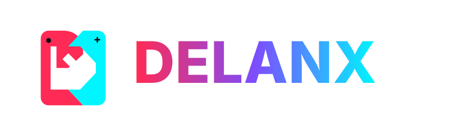

<p align="center">
  <picture>
    <source media="(prefers-color-scheme: dark)" srcset="docs/assets/delanx-horizontal-dark.svg">
    <source media="(prefers-color-scheme: light)" srcset="docs/assets/delanx-horizontal-light.svg">
    
  </picture>
</p>

# Delanx — Homebrew Port & Decompilation Manager para Nintendo Switch

<p align="center">
  <a href="https://github.com/KidFeroz/Delanx/releases"></a>
  <a href="LICENSE"></a>
  <a href="https://en.cppreference.com/w/cpp/20"></a>
  <a href="https://github.com/switchbrew/libnx"></a>
  <a href="https://devkitpro.org"></a>
  <a href="https://github.com/KidFeroz"></a>
  <a href="#-de-entusiasta-a-entusiasta-vibecoding-y-comunidad"></a>
</p>

<p align="center">
  <a href="#-español"><b>🇪🇸 Español</b></a> &nbsp;|&nbsp; <a href="#-english"><b>🇬🇧 English</b></a>
</p>

<a name="-español"></a>

**Delanx** es un gestor y cargador (*launcher*) nativo implementado en **C++20** para Nintendo Switch (Horizon OS). Su propósito es organizar, verificar la presencia de archivos requeridos y ejecutar adaptaciones de código (*source ports*), decompilaciones (*decomps*) y recompilaciones (*recomps*) dentro del ecosistema homebrew.

> [!NOTE]
> **Hecho por un entusiasta en casa con asistencia de IA (*Vibecoding*)**  
> Este proyecto no nace de una persona experta: soy un apasionado del homebrew desarrollando y probando directamente en mi Nintendo Switch en casa, lamentablemente me considero solo orquestador con inteligencia artitificial para la programación en C++.
> 
> * 🎮 **Probado en consola real:** El código se compila y se testea directamente en mi consola.
> * 🤝 **100% abierto a aportes humanos:** Si programas en C++, conoces `libnx`/`SDL2` o quieres ayudar a pulir la arquitectura, ¡eres más que bienvenido! Las Pull Requests y revisiones humanas son apreciadas.
> * ✌️ **Buena vibra y respeto:** Entiendo perfectamente que a muchas personas no les agrada el *vibecoding* con IA y respeto totalmente esa postura. Solo pido esa misma tolerancia y respeto en los Issues y debates: las críticas técnicas y constructivas son bienvenidas, aquí estamos para sumar a la comunidad homebrew y pasarla bien. 🕹️

---

## 📌 Tabla de Contenidos

- [Aviso de Desarrollo con IA](#-aviso-de-desarrollo-asistido-por-ia-vibecoding-y-auditoría-comunitaria)
- [Motivación Técnica e Inspiración](#-motivación-técnica-e-inspiración)
- [Arquitectura del Sistema](#-arquitectura-del-sistema)
- [Características Principales](#-características-principales)
- [Estructura en Tarjeta MicroSD](#-estructura-en-tarjeta-microsd)
- [Compilación y Toolchain](#-compilación-y-toolchain)
- [Batería de Pruebas y Auditoría](#-batería-de-pruebas-y-auditoría)
- [De Entusiasta a Entusiasta: Vibecoding y Comunidad](#-de-entusiasta-a-entusiasta-vibecoding-y-comunidad)
- [Guía para Contribuidores](#-guía-para-contribuidores)
- [Licencia y Reconocimientos](#-licencia-y-reconocimientos)

---

## ⚙️ Enfoque y Diseño

Delanx fue diseñado para ser un entorno nativo, rápido y autónomo en Horizon OS:

1. **Desarrollo 100% Nativo:** Código C++20 compilado directamente contra `libnx`, `SDL2` y portlibs de `devkitPro` para un arranque instantáneo y uso mínimo de RAM en consola.
2. **Esquema de Datos Flexible (`apps.json`):** Adopta un formato JSON tolerante y extensible, permitiendo compatibilidad opcional con bibliotecas existentes mientras gestiona los parámetros propios de Switch bajo el objeto `"switch"`.
3. **Gestión Directa de Ports:** Diseñado específicamente para detectar ejecutables `.nro`, validar archivos de datos complementarios aportados por el usuario y ejecutar títulos sin depender de capas intermedias.

```json
{
  "name": "Custom Port Example",
  "folderName": "custom_port",
  "installPath": "/switch/custom_port",
  "switch": {
    "targetDir": "/switch/custom_port",
    "nro": "custom_port.nro",
    "requiredUserFiles": [
      { "path": "sdmc:/switch/custom_port/assets.otr", "present": true }
    ]
  }
}
```

---

## 🏛️ Arquitectura del Sistema

El diseño sigue una separación estricta de responsabilidades por capas sin dependencias cíclicas:

```
source/
├── core/       -> Primitivas de bajo nivel: JSON (jansson), paths (sdmc:/), hashing SHA-256, logs.
├── model/      -> Entidades de dominio desacopladas: AppEntry, CatalogEntry, Release, Settings.
├── services/   -> Lógica de infraestructura: HTTP (libcurl), libarchive (descompresión), artwork.
├── platform/   -> Abstracción de Horizon OS: libnx HID, applet/application mode, gestión de batería y red.
└── ui/         -> Renderizado gráfico SDL2: vistas (Grid/List), componentes, layout y bucle de eventos.
```

### Reglas de Dependencia
`UI` $\longrightarrow$ `Services` $\longrightarrow$ `Model` $\longrightarrow$ `Core`  
*(La capa `Platform` es consumida exclusivamente por el punto de entrada `main.cpp` y subsistemas de servicios concretos).*

### Flujo de Ejecución e Intercambio de Contexto
Delanx implementa el protocolo de encadenamiento binario de `libnx` (`envSetNextLoad`):
1. El usuario selecciona un título verificado en la interfaz.
2. Delanx comprueba los activos o datos requeridos por el ejecutable.
3. Se invoca `envSetNextLoad(target_nro_path, target_argv)`.
4. Delanx libera sus recursos (contexto SDL2, descriptores de archivos, buffers de red) y finaliza con código de salida limpio.
5. El cargador del entorno (`hbmenu` o forwarder NSP) ejecuta de forma atómica el NRO objetivo.

---

## 🚀 Características Principales

* **Catálogo Maestro de 45+ Proyectos:** Base de datos validada con ports, decomps y adaptaciones de la comunidad.
* **Compatibilidad de Formatos y Extensiones:** Detección y verificación de integridad para los formatos más extendidos del homebrew:
  - **Ejecutables nativos:** `.nro`
  - **Paquetes de assets / recomps:** `.otr`, `.o2r`, `.rcf`, `.wad`, `.pk3`, `.grp`, `.dat`, `.pak`
  - **Archivos de imagen y ROMs base:** `.z64`, `.sfc`, `.gba`, `.bin`, `.cue`, `.iso`
  - **Metadatos y configuración:** `.json`, `.ini`, `.cfg`
* **Integridad Criptográfica:** Validación obligatoria por hash **SHA-256** de paquetes descargados frente a manifiestos de catálogo (*verified / unverified / blocked*).
* **Mitigación de Vulnerabilidades de Descompresión:** Extractor de archivos basado en `libarchive` con validación estricta contra ataques de desbordamiento de rutas (*path traversal / zip-slip*).
* **Arte y Carátulas a Costo Cero ($0):** Arquitectura híbrida que consume CDNs públicos sin API Keys:
  - *Libretro Thumbnails* para sistemas retro con nomenclatura No-Intro.
  - *SteamGridDB* para adaptaciones modernas de PC e indies.
* **Soporte de Entorno Dual:** Detección de ejecución en **Applet Mode** (memoria restringida de 400 MB) vs **Application Mode / Title Override** (acceso a ~3.2 GB de RAM), adaptando las cuotas de caché y resolución de texturas dinámicamente.
* **Entrada Robusta:** Lectura directa mediante `libnx HID` (sticks analógicos, botones y pantalla táctil capacitiva).

---

## 📂 Estructura en Tarjeta MicroSD

Delanx estandariza la jerarquía de almacenamiento respetando las convenciones comunitarias de Nintendo Switch:

```text
sdmc:/
├── roms/                               # Depósito central de assets y ROMs base
│   ├── cart/                           # Formatos de cartucho (.z64, .sfc, .gba)
│   ├── disc/                           # Imágenes de disco (.bin / .cue / .iso)
│   └── data/                           # Paquetes de datos y recursos (.wad, .pk3, .grp, .rcf)
│
└── switch/                             # Directorio estándar de aplicaciones Homebrew
    ├── Delanx/
    │   ├── Delanx.nro                  # Ejecutable principal
    │   ├── apps.json                   # Base de datos local de títulos instalados
    │   ├── settings.json               # Configuración persistente del usuario
    │   ├── Cache/                      # Miniaturas descargadas (.png)
    │   └── delanx.log                  # Registro de diagnóstico en ejecución
    │
    ├── custom_port/                    # Ejemplo: Carpeta aislada de una app
    │   ├── custom_port.nro             # Ejecutable NRO
    │   └── assets.otr                  # Archivo de recursos requerido (.otr, .o2r, .pak, etc.)
    └── [resto_de_apps]/
```

---

## 🛠️ Compilación y Toolchain

### Prerrequisitos
Se requiere el entorno oficial de desarrollo cruzado **devkitPro** para arquitectura ARM64 (`devkitA64`):

* `devkitA64`
* `libnx`
* Portlibs de Switch:
  ```bash
  pacman -S --needed switch-dev switch-examples \
      switch-sdl2 switch-sdl2_image switch-sdl2_ttf \
      switch-libcurl switch-jansson switch-libarchive switch-freetype
  ```

### Variables de Entorno
Asegúrate de definir la variable base:
```bash
export DEVKITPRO=/opt/devkitpro
```

### Proceso de Construcción
```bash
# Limpiar compilaciones previas
make clean

# Compilar binarios (.elf, .nacp y .nro empaquetado con romfs)
make -j$(nproc)
```

El proceso generará en la raíz del repositorio:
* `Delanx.nro`: Binario ejecutable final para Horizon OS.
* `Delanx.nacp`: Archivo de metadatos del título (ID, autor, versión).
* `Delanx.elf`: Binario ELF intermedio con símbolos de depuración.

---

## 🧪 Batería de Pruebas y Auditoría

La integridad del código se audita mediante dos capas independientes de verificación:

### 1. Pruebas Nativas en Host (`tests/host`)
Permiten probar el motor en Linux/macOS/Windows sin necesidad de hardware físico o emulador:
* **Capa de Datos (`test_data_layer.cpp`):** Serialización y tolerancia a fallos de esquemas JSON.
* **Capa de Red (`test_network_layer.cpp`):** Mocking de endpoints HTTP, descargas por bloques y gestión de timeouts.
* **Instalador Seguro (`test_installer.cpp`):** Pruebas de descompresión real con paquetes de prueba y verificación de preservación de ficheros de usuario.

```bash
cd tests/host
./run.sh
```

### 2. Autotest en Hardware Real (`tests/device`)
Validación de hardware sobre Horizon OS:
* Comprobación del subsistema de montaje `romfs:/` y `sdmc:/`.
* Verificación de asignación de memoria heap en modo Title Override.
* Lectura del estado de la batería, conexión de red y reloj RTC.

---

## 🤖 De Entusiasta a Entusiasta: Vibecoding y Comunidad

Este proyecto está hecho por pura pasión por el homebrew y la preservación de videojuegos. Para poder construir un launcher completo en C++ sin pasar meses picando código repetitivo desde cero, me apoyé en un agente de IA (**Vibecoding**) como copiloto de programación.

### Cómo se construye y prueba Delanx:
1. **Desarrollo Asistido:** La IA ayuda a escribir la estructura, parsear JSON, enlazar librerías (`libcurl`, `libarchive`) y generar casos de prueba.
2. **Pruebas en Casa:** Todo se compila con `devkitA64` y lo pruebo directamente en mi propia Nintendo Switch y tarjeta SD, asegurando que funcione bien en hardware real.
3. **100% Abierto a Aportes Humanos:** El proyecto nació vibecodeado, pero no es exclusivo de máquinas. ¡Al contrario! Si eres dev y quieres auditar, optimizar memoria o enviar Pull Requests, tu ayuda es más que bienvenida.
4. **Espacio de Buena Onda y Tolerancia:** Se entiende y se respeta que a muchos en la comunidad no les guste el desarrollo con IA. Cualquier sugerencia técnica, reporte de error o mejora es bienvenida; solo pedimos mantener el respeto mutuo en Issues y Discussions. Al final, lo que nos une a todos es disfrutar de los ports en nuestra consola. 🎮✨

---

## 🤝 Guía para Contribuidores

Agradecemos las contribuciones de la comunidad. Para mantener la robustez y calidad de la base de código, solicitamos seguir estas directrices:

1. **Estándar C++20:**
   - Evitar RTTI (`-fno-rtti`) y excepciones (`-fno-exceptions`) para alinearse con los lineamientos de rendimiento de consolas empotradas.
   - Usar semántica de movimiento (`std::move`) y punteros inteligentes (`std::unique_ptr`) para control determinista de memoria.
2. **Formato de Código:**
   - Respetar el archivo de configuración `.clangd` incluido en la raíz del proyecto.
3. **Nuevos Ports en el Catálogo:**
   - Al sugerir un nuevo port en `switch_ports_catalog.md` o en `romfs/catalog/switch-catalog.json`, incluye el enlace al release de GitHub, el nombre exacto del archivo `.nro` interno, la ruta esperada de datos y el hash SHA-256 del asset.
4. **Flujo de Pull Requests:**
   - Realizar commits descriptivos (`feat:`, `fix:`, `refactor:`, `docs:`).
   - Asegurarse de que `make` compile sin advertencias (`-Wall -Wextra`).

---

## 📄 Licencia y Reconocimientos

Desarrollado y mantenido por **[KidFeroz](https://github.com/KidFeroz)**. Este software es libre y se distribuye bajo los términos de la licencia **GNU General Public License v3.0 (GPLv3)**. Consulta el archivo [LICENSE](LICENSE) para más detalles. Esta licencia garantiza que Delanx y cualquier fork o trabajo derivado permanezcan siempre libres y abiertos para la comunidad.

### 💖 Créditos de Código Abierto y Agradecimientos

Agradecemos profundamente a los siguientes proyectos y desarrolladores del ecosistema abierto:

* **[devkitPro](https://devkitpro.org) & [Switchbrew (libnx)](https://github.com/switchbrew/libnx):** Por la toolchain devkitA64 y la biblioteca base `libnx` que hace posible el desarrollo nativo en Nintendo Switch.
* **[The Homebrew App Store](https://github.com/fortheusers/hb-appstore) (`fortheusers`):** Por el ecosistema pionero de catálogos y gestión de paquetes homebrew para Switch.
* **[Quiver Launcher](https://github.com/tgeorgiadis/quiver-launcher) (`tgeorgiadis`):** Por la inspiración inicial en esquemas de catálogo y estructura de decompilaciones.
* **[Harbour Masters](https://github.com/HarbourMasters):** Por los extraordinarios proyectos de ingeniería inversa y descompilación: Shipwright (*Ocarina of Time*), Starship (*Star Fox 64*), Ghostship (*Super Mario 64*) y Spaghettify (*Mario Kart 64*).
* **[YoshiCrystal9](https://github.com/YoshiCrystal9/2ship2harkinian-Switch):** Por el port nativo de 2 Ship 2 Harkinian (*Majora's Mask*) para Nintendo Switch.
* **[SDL2](https://www.libsdl.org/) & extensiones (`SDL2_image`, `SDL2_ttf`):** Por la robusta capa de renderizado 2D, decodificación de texturas y gestión de fuentes tipográficas y controles.
* **[libcurl](https://curl.se/) & [mbedtls](https://github.com/Mbed-TLS/mbedtls):** Por el soporte de red y comunicación cifrada con APIs REST.
* **[Jansson](https://github.com/akheron/jansson):** Por la librería ligera de análisis y serialización JSON en C.
* **[libarchive](https://www.libarchive.org/):** Por el motor eficiente y seguro de descompresión de archivos ZIP, 7z y tarballs.
* **[SteamGridDB](https://www.steamgriddb.com/) & [libretro-thumbnails](https://github.com/libretro/libretro-thumbnails):** Por los repositorios de carátulas e iconografía de la comunidad de preservación.
* **Tipografías:** Barlow Condensed, Cal Sans e Inter (licenciadas bajo SIL Open Font License).
* **A toda la comunidad de decompilación y preservación:** A todos los equipos de ingeniería inversa y homebrew que hacen posible disfrutar de estas obras maestras de forma nativa en Nintendo Switch.

---

<a name="-english"></a>

# Delanx — Homebrew Port & Decompilation Manager for Nintendo Switch

**Delanx** is a native launcher and manager implemented in **C++20** for Nintendo Switch (Horizon OS). Its purpose is to organize, verify required asset files, and launch source ports, decompilations (*decomps*), and recompilations (*recomps*) within the homebrew ecosystem.

> [!NOTE]
> **Crafted by an enthusiast at home with AI assistance (*Vibecoding*)**  
> This project was not created by an expert: I am a passionate homebrew enthusiast developing and testing directly on my Nintendo Switch at home, acting primarily as an orchestrator with artificial intelligence for the C++ programming.
> 
> * 🎮 **Tested on real hardware:** Code is compiled and tested directly on my personal console.
> * 🤝 **100% open to human contributions:** If you write C++, know `libnx`/`SDL2`, or want to help polish the architecture, you are more than welcome! Pull Requests and human reviews are deeply appreciated.
> * ✌️ **Good vibes and respect:** I completely understand that many people dislike AI *vibecoding*, and I fully respect that stance. I only ask for that same tolerance and respect in Issues and discussions: technical and constructive feedback is welcome; we are here to contribute to the homebrew community and have a good time. 🕹️

---

## 📌 Table of Contents

- [Approach and Design](#-approach-and-design)
- [System Architecture](#-system-architecture-1)
- [Key Features](#-key-features-1)
- [MicroSD Card Structure](#-microsd-card-structure-1)
- [Toolchain and Building](#-toolchain-and-building)
- [Test Suite and Auditing](#-test-suite-and-auditing)
- [From Enthusiast to Enthusiast: Vibecoding and Community](#-from-enthusiast-to-enthusiast-vibecoding-and-community)
- [Contributor Guide](#-contributor-guide-1)
- [License and Acknowledgments](#-license-and-acknowledgments-1)

---

## ⚙️ Approach and Design

Delanx was designed to provide a fast, native, and self-contained environment on Horizon OS:

1. **100% Native Development:** C++20 code compiled directly against `libnx`, `SDL2`, and `devkitPro` portlibs for instant boot times and minimal console RAM consumption.
2. **Flexible Data Schema (`apps.json`):** Adopts a resilient and extensible JSON schema, allowing optional interoperability with existing libraries while managing Switch-specific parameters under the `"switch"` object.
3. **Direct Port Management:** Specifically designed to detect `.nro` executables, validate user-provided complementary asset files, and launch games without relying on intermediate layers.

```json
{
  "name": "Custom Port Example",
  "folderName": "custom_port",
  "installPath": "/switch/custom_port",
  "switch": {
    "targetDir": "/switch/custom_port",
    "nro": "custom_port.nro",
    "requiredUserFiles": [
      { "path": "sdmc:/switch/custom_port/assets.otr", "present": true }
    ]
  }
}
```

---

## 🏛️ System Architecture

The design follows a strict layered separation of concerns with zero cyclical dependencies:

```
source/
├── core/       -> Low-level primitives: JSON (jansson), paths (sdmc:/), SHA-256 hashing, logging.
├── model/      -> Decoupled domain entities: AppEntry, CatalogEntry, Release, Settings.
├── services/   -> Infrastructure logic: HTTP (libcurl), libarchive (extraction), artwork, scanner.
├── platform/   -> Horizon OS abstraction: libnx HID, applet/application mode, battery and network state.
└── ui/         -> SDL2 graphics rendering: views (Grid/List), components, layout, and event loop.
```

### Dependency Rules
`UI` $\longrightarrow$ `Services` $\longrightarrow$ `Model` $\longrightarrow$ `Core`  
*(The `Platform` layer is consumed exclusively by the `main.cpp` entrypoint and concrete service subsystems).*

### Execution Flow and Context Switching
Delanx implements the `libnx` binary chaining protocol (`envSetNextLoad`):
1. The user selects a verified title in the interface.
2. Delanx verifies required complementary assets and data files.
3. Invokes `envSetNextLoad(target_nro_path, target_argv)`.
4. Delanx cleanly frees its resources (SDL2 context, file descriptors, network buffers) and exits with code 0.
5. The environment loader (`hbmenu` or forwarder NSP) atomically executes the target NRO.

---

## 🚀 Key Features

* **45+ Project Master Catalog:** Validated database with ports, decomps, and community adaptations.
* **Format and Extension Compatibility:** Detection and integrity verification for the most common homebrew formats:
  - **Native executables:** `.nro`
  - **Asset packs / recomps:** `.otr`, `.o2r`, `.rcf`, `.wad`, `.pk3`, `.grp`, `.dat`, `.pak`
  - **Disk images and base ROMs:** `.z64`, `.sfc`, `.gba`, `.bin`, `.cue`, `.iso`
  - **Metadata and configuration:** `.json`, `.ini`, `.cfg`
* **Cryptographic Integrity:** Mandatory **SHA-256** hash validation of downloaded packages against catalog manifests (*verified / unverified / blocked*).
* **Archive Extraction Vulnerability Mitigation:** `libarchive`-based extractor with strict protection against path traversal and zip-slip attacks.
* **Zero-Cost Artwork ($0):** Hybrid architecture fetching from public CDNs without API keys:
  - *Libretro Thumbnails* for retro systems using No-Intro naming.
  - *SteamGridDB* for modern PC adaptations and indies.
* **Dual Environment Support:** Automatic detection of **Applet Mode** (~400 MB memory limit) vs **Application Mode / Title Override** (~3.2 GB RAM access), dynamically adjusting cache limits and texture resolutions.
* **Robust Input:** Direct input polling via `libnx HID` (analog sticks, D-pad, buttons, and capacitive multi-touch).

---

## 📂 MicroSD Card Structure

Delanx standardizes storage hierarchy following established Nintendo Switch community conventions:

```text
sdmc:/
├── roms/                               # Central repository for base ROMs and assets
│   ├── cart/                           # Cartridge formats (.z64, .sfc, .gba)
│   ├── disc/                           # Disc images (.bin / .cue / .iso)
│   └── data/                           # Data packs and game resources (.wad, .pk3, .grp, .rcf)
│
└── switch/                             # Standard Homebrew applications directory
    ├── Delanx/
    │   ├── Delanx.nro                  # Main executable
    │   ├── apps.json                   # Local installed titles database
    │   ├── settings.json               # Persistent user settings
    │   ├── Cache/                      # Downloaded thumbnails (.png)
    │   └── delanx.log                  # Runtime diagnostic log
    │
    ├── custom_port/                    # Example: Isolated app directory
    │   ├── custom_port.nro             # NRO executable
    │   └── assets.otr                  # Required asset file (.otr, .o2r, .pak, etc.)
    └── [other_apps]/
```

---

## 🛠️ Toolchain and Building

### Prerequisites
Requires the official **devkitPro** cross-compilation toolchain for ARM64 architecture (`devkitA64`):

* `devkitA64`
* `libnx`
* Switch portlibs:
  ```bash
  pacman -S --needed switch-dev switch-examples \
      switch-sdl2 switch-sdl2_image switch-sdl2_ttf \
      switch-libcurl switch-jansson switch-libarchive switch-freetype
  ```

### Environment Variables
Ensure the base environment variable is set:
```bash
export DEVKITPRO=/opt/devkitpro
```

### Build Process
```bash
# Clean previous builds
make clean

# Compile binaries (.elf, .nacp, and .nro bundled with romfs)
make -j$(nproc)
```

The build process produces in the repository root:
* `Delanx.nro`: Final Horizon OS executable binary.
* `Delanx.nacp`: Title metadata file (ID, author, version).
* `Delanx.elf`: Intermediate ELF binary with debug symbols.

---

## 🧪 Test Suite and Auditing

Code integrity is audited across two independent verification layers:

### 1. Native Host Tests (`tests/host`)
Allows testing the core engine on Linux, macOS, or Windows without requiring physical hardware or emulators:
* **Data Layer (`test_data_layer.cpp`):** JSON schema serialization, fault tolerance, and multi-token fuzzy signature detection.
* **Network Layer (`test_network_layer.cpp`):** HTTP endpoint mocking, chunked downloads, and timeout handling.
* **Safe Installer (`test_installer.cpp`):** Real package extraction testing and preservation of user-provided files.

```bash
cd tests/host
./run.sh
```

### 2. Real Hardware Autotest (`tests/device`)
Hardware validation running on Horizon OS:
* Verification of `romfs:/` and `sdmc:/` filesystem mounting.
* Verification of heap memory allocation in Title Override mode.
* Polling battery status, network state, and RTC clock.

---

## 🤖 From Enthusiast to Enthusiast: Vibecoding and Community

This project is driven by pure passion for homebrew and game preservation. To build a complete C++ launcher without spending months writing repetitive boilerplate code from scratch, I leaned on an AI assistant (**Vibecoding**) as a programming co-pilot.

### How Delanx is Built and Tested:
1. **Assisted Development:** AI assists with project structure, JSON parsing, library binding (`libcurl`, `libarchive`), and test case generation.
2. **Home Testing:** Everything is compiled with `devkitA64` and tested directly on my personal Nintendo Switch and SD card, ensuring it performs reliably on real hardware.
3. **100% Open to Human Contributions:** While started with AI assistance, this project is not exclusive to machines. Quite the opposite! If you are a developer interested in auditing code, optimizing memory, or opening Pull Requests, your help is warmly welcomed.
4. **Good Vibes and Mutual Respect:** It is understandable that some in the community have reservations about AI-assisted development. Any technical suggestions, bug reports, or improvements are welcome; we simply ask to keep discussions in Issues and Discussions respectful and constructive. Ultimately, what unites us all is enjoying great ports natively on our console. 🎮✨

---

## 🤝 Contributor Guide

Community contributions are warmly appreciated. To maintain codebase robustness and quality, please follow these guidelines:

1. **C++20 Standard:**
   - Avoid RTTI (`-fno-rtti`) and exceptions (`-fno-exceptions`) in line with embedded console performance practices.
   - Use move semantics (`std::move`) and smart pointers (`std::unique_ptr`) for deterministic memory management.
2. **Code Formatting:**
   - Follow the `.clangd` configuration included in the project root.
3. **Adding Ports to the Catalog:**
   - When proposing a new port in `romfs/catalog/switch-catalog.json`, include the GitHub release link, the exact internal `.nro` filename, expected asset paths, and the asset SHA-256 hash.
4. **Pull Request Workflow:**
   - Write descriptive commit messages (`feat:`, `fix:`, `refactor:`, `docs:`).
   - Ensure `make` builds cleanly without warnings (`-Wall -Wextra`).

---

## 📄 License and Acknowledgments

Developed and maintained by **[KidFeroz](https://github.com/KidFeroz)**. This software is free and open source, distributed under the terms of the **GNU General Public License v3.0 (GPLv3)**. See the [LICENSE](LICENSE) file for details. This license guarantees that Delanx and any derivative works remain forever free and open for the community.

### 💖 Open Source Credits and Special Thanks

We deeply appreciate the following open-source projects and developers:

* **[devkitPro](https://devkitpro.org) & [Switchbrew (libnx)](https://github.com/switchbrew/libnx):** For the devkitA64 toolchain and foundational `libnx` library enabling native Nintendo Switch development.
* **[The Homebrew App Store](https://github.com/fortheusers/hb-appstore) (`fortheusers`):** For pioneering homebrew package management and catalogs on Switch.
* **[Quiver Launcher](https://github.com/tgeorgiadis/quiver-launcher) (`tgeorgiadis`):** For early inspiration in catalog schemas and decompilation structures.
* **[Harbour Masters](https://github.com/HarbourMasters):** For their extraordinary reverse engineering and decompilation projects: Shipwright (*Ocarina of Time*), Starship (*Star Fox 64*), Ghostship (*Super Mario 64*), and Spaghettify (*Mario Kart 64*).
* **[YoshiCrystal9](https://github.com/YoshiCrystal9/2ship2harkinian-Switch):** For the native Nintendo Switch port of 2 Ship 2 Harkinian (*Majora's Mask*).
* **[SDL2](https://www.libsdl.org/) & extensions (`SDL2_image`, `SDL2_ttf`):** For the reliable 2D rendering, texture decoding, font management, and gamepad input layer.
* **[libcurl](https://curl.se/) & [mbedtls](https://github.com/Mbed-TLS/mbedtls):** For network communication and secure TLS transfers.
* **[Jansson](https://github.com/akheron/jansson):** For the fast, lightweight C JSON parsing library.
* **[libarchive](https://www.libarchive.org/):** For secure, high-performance ZIP, 7z, and tarball extraction.
* **[SteamGridDB](https://www.steamgriddb.com/) & [libretro-thumbnails](https://github.com/libretro/libretro-thumbnails):** For community artwork repositories and game icon databases.
* **Typefaces:** Barlow Condensed, Cal Sans, and Inter (licensed under the SIL Open Font License).
* **To the entire decompilation and preservation community:** To all reverse engineering and homebrew teams making it possible to experience these timeless masterpieces natively on Nintendo Switch.
